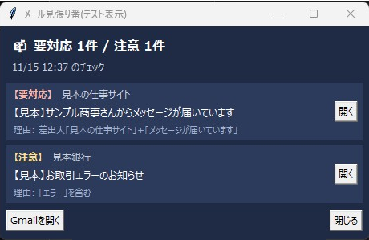

# メール見張り番（Mail Notifier）

決まった間隔でGmailをチェックし、**対応が必要なメール・注意が必要なメールだけ**を
画面右下のポップアップで知らせる、Windows用の常駐ソフトです。
広告やメルマガは知らせず、仕事に関係するメールだけを【要対応】【注意】に分けて表示します。

## 作ったきっかけ
副業・案件探しをしていると、応募先からの返信や面談の日程調整のメールが、
大量の広告メールに埋もれて見落としがちでした。
「必要なものだけ、気づける形で知らせてほしい」と考え、AIを利用して作成し、
現在は自分のパソコンで毎日使っています。

## できること
- 指定した間隔（初期設定60分）・時間帯・曜日にGmailを自動チェック
- 受信トレイから外れた（アーカイブされた）メールも対象
- 差出人とキーワードのルールで【要対応】【注意】【知らせない】を判定
- ポップアップの「開く」ボタンで、そのメールをGmailで直接表示
- メールは読むだけで、既読化・削除はしない
- Python標準ライブラリのみで動作（追加インストール不要）

## 判定のしくみ
| 順 | 条件 | 結果 |
| --- | --- | --- |
| 1 | 除外する差出人／件名の除外キーワード | 知らせない |
| 2 | 仕事関係の差出人 ＋ 要対応キーワード | 要対応 |
| 3 | 件名に要対応キーワード | 要対応 |
| 4 | 注意キーワード | 注意 |
| 5 | 仕事関係の差出人のみ | 注意 |

ルールは設定ファイルに1行ずつ書き足すだけで変えられます。

## 工夫した点
- 前回どこまで見たかを記録し、同じメールを二度知らせない
- 初回起動時は数時間前までさかのぼって確認
- 日本語の件名・本文（文字コード混在）を正しく読み取る
- ログイン失敗や設定不足も、ポップアップで原因を表示
- バッチファイルで「起動・停止・今すぐチェック・自動起動登録」をダブルクリックで操作

## 使い方
1. Googleアカウントで2段階認証をオンにし、アプリパスワード（16桁）を発行
2. `config.example.ini` をコピーして `config.ini` にし、アドレスとアプリパスワードを記入
3. `テスト表示.bat` で表示を確認 → `今すぐチェック.bat` で動作確認
4. `起動.bat` で常駐開始（`自動起動に登録.bat` でPC起動時に自動開始）

※ `config.ini` にはアプリパスワードが入るため、公開・共有しないでください（.gitignoreで除外済み）。

## 動作環境
- Windows 10 / 11
- Python 3.9 以降
- Gmail（IMAP・アプリパスワード）

## ファイル
| ファイル | 内容 |
| --- | --- |
| mail_notifier.py | 本体 |
| config.example.ini | 設定の見本 |
| 起動.bat / 停止.bat | 常駐の開始・停止 |
| 今すぐチェック.bat | 時間外でも1回チェック |
| テスト表示.bat | ポップアップの見本表示 |
| 自動起動に登録.bat / 自動起動を解除.bat | PC起動時の自動開始 |
